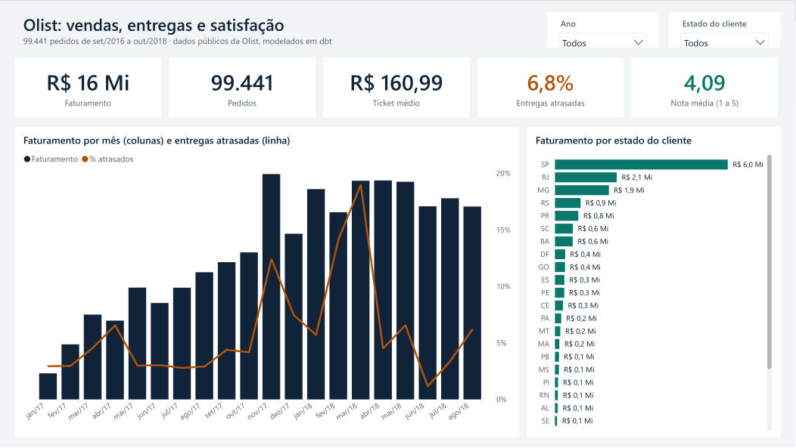
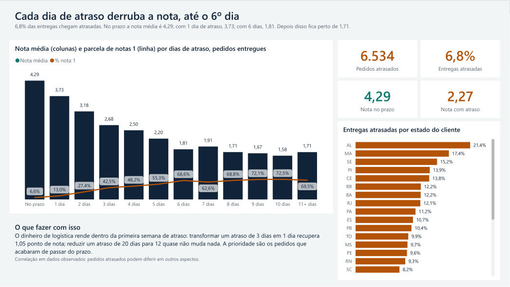
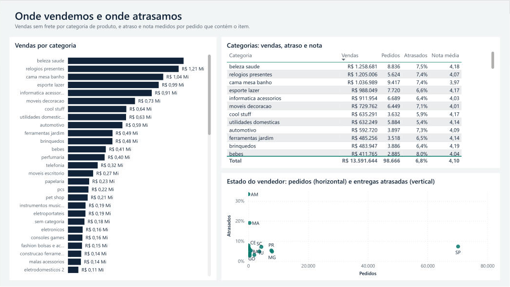
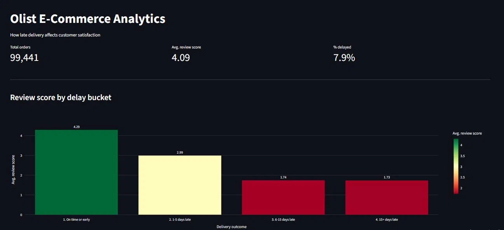
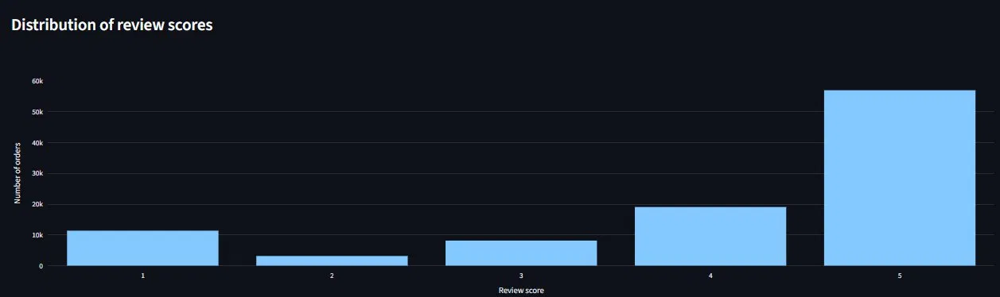

# Olist E-Commerce Analytics

[](https://github.com/DiegoTDDD/olist-analytics/actions/workflows/dbt-check.yml)
[](LICENSE)

**Problem.** An e-commerce marketplace knows that late deliveries hurt reviews. What it does not know is how much they hurt, how quickly, and whether operations should cut the size of delays or prevent them altogether.

**Solution.** A tested star schema built with dbt on DuckDB over about 100,000 real Olist orders, a three-page Power BI report with 22 DAX measures on top of it, and a Streamlit dashboard.

**📊 Power BI:** [download `OlistEntregas.pbix`](https://github.com/DiegoTDDD/olist-analytics/raw/main/powerbi/OlistEntregas.pbix) or open [`powerbi/OlistEntregas.pbip`](powerbi/) · **🔗 Live dashboard:** https://diegotddd-olist-analytics.streamlit.app · **Design decisions:** [`docs/adr/`](docs/adr/README.md)

## Key finding

6.8% of delivered orders arrive late, and every day of delay costs rating until about the sixth day. After that the rating stays near its floor, so extra days hardly matter any more.

| Delivered | Orders | Avg. review score | 1-star share |
|---|---:|---:|---:|
| On time or early | 89,936 | 4.29 | 6.6% |
| 1 day late | 825 | 3.73 | 13.0% |
| 3 days late | 500 | 2.68 | 42.5% |
| 6 days late | 419 | 1.81 | 68.6% |
| 11+ days late | 2,092 | 1.71 | 69.5% |

The business implication: logistics money pays off inside the first week of a delay. Turning a 3-day delay into a 1-day one recovers about one point of rating; turning a 20-day delay into a 12-day one recovers almost none. The orders that just missed their date are the ones to rescue first. This is correlation in observational data: late orders may differ in other ways.

**Model quality:** 15 dbt models and 47 tests, run on every change from the raw files, including seven singular tests for the business rules ([below](#data-quality-tests)).

## Power BI report

Three pages on the same star schema, in Portuguese, generated as code: [`powerbi/build_pbip.py`](powerbi/build_pbip.py) writes the semantic model (TMDL: tables, relationships, a marked date table, 22 DAX measures) and the report pages (PBIR), and the texts on the pages are computed from the data. CI regenerates the project and fails if it differs from the committed one.







Measures include revenue, average ticket, year-over-year growth (`SAMEPERIODLASTYEAR`), late-delivery rate, rating on time vs. late, 1-star share, and item-level measures that count each order once (`AVERAGEX` over `VALUES`). The monthly chart shows January 2017 to August 2018 only, through measures, because the months before and after have a handful of orders and a late rate over a dozen orders swings to 0% or 100%.

**To open it:** download [`OlistEntregas.pbix`](https://github.com/DiegoTDDD/olist-analytics/raw/main/powerbi/OlistEntregas.pbix) (17 MB, data included) and open it in Power BI Desktop, or clone the repository and open `powerbi/OlistEntregas.pbip` in Power BI Desktop and refresh. Either way the data comes from the Parquet files committed in [`data/powerbi/`](data/powerbi/); to use a local copy, change the `DataFolder` parameter (Transform data > Edit parameters).

## Dashboard

An interactive Streamlit dashboard presents the findings. It is deployed live (link above); screenshots below in case the app is asleep.





## Business questions

The dimensional model is built to support three analytical areas, with delivery vs. satisfaction as the anchor:

- **Delivery performance and satisfaction** (anchor) — do late orders receive worse reviews, and how much worse?
- **Customer behavior** — repeat purchase patterns and cohort retention.
- **Seller and category performance** — which sellers and product categories drive value or drag down operations.

## Data model

The project follows a layered dbt architecture and a star schema.

**Staging layer** — one lightly cleaned view per source table: columns renamed to a consistent English convention, types adjusted, and the original dataset's typo (`product_name_lenght`) corrected. No business logic.

**Marts layer** — a star schema:

- `fct_orders` — one row per order, with measures: order value, payment installments, item count, freight, review score, delivery days, delay days, and an `is_delayed` flag (delivered on a later calendar day than promised; [ADR 0003](docs/adr/0003-late-means-a-later-calendar-day.md)). The review score uses the most recent review per order (via a window function) to avoid averaging multiple reviews into fractional scores.
- `dim_customers` — customer identity and location (preserving both `customer_id` per order and `customer_unique_id` per person).
- `dim_products` — product attributes joined to the English category translation.
- `dim_sellers` — seller identity and location.
- `fct_order_items` — one row per item sold, with the order's status, date, delay and review carried on it, for category and seller analysis.
- `dim_dates` — a date spine with year, quarter, month, day of week, and weekend flag.

The `delay_days` measure (actual delivery date minus the estimated date) is the metric that links operations to customer satisfaction.

## Data quality tests

`dbt build` runs 47 tests before anything is published:

- **Sources (17):** unique and not-null primary keys on orders, customers, products, sellers and category translations; order items that point at real orders; review scores between 1 and 5. The CSV files themselves are checked against pinned SHA-256 hashes.
- **Models (20):** unique and not-null keys on every dimension and on the order fact, the relationship from `fct_orders` to `dim_customers`, review scores between 1 and 5, the relationships from every item in `fct_order_items` to its order, product and seller, and a Portuguese display name for every product category.
- **Seed (3):** `category_names_pt`, the category names shown in the Power BI report (with accents), has one row per category.
- **Business rules (7 singular tests in `olist_dbt/tests/`):**
  - exactly one fact row per order, so no join duplicates or drops orders;
  - `is_delayed` agrees with `delay_days > 0`;
  - no delivery before purchase;
  - no negative amounts;
  - delivered orders have a delivery date (warning above 10);
  - exactly one item row per order item;
  - item prices and freight add up, order by order, to the totals on `fct_orders`.

The tests have caught two real bugs:

- **Averaging multiple reviews produced fractional scores.** Fixed by keeping the most recent review ([ADR 0002](docs/adr/0002-latest-review-per-order.md)).
- **`is_delayed` compared timestamps against a promise stored as midnight.** That flagged 1,292 orders delivered on the promised day as late and inflated the dashboard's "% delayed" from 6.6% to 7.9% ([ADR 0003](docs/adr/0003-late-means-a-later-calendar-day.md)).

There is no source freshness check, because this is a fixed historical snapshot ([ADR 0004](docs/adr/0004-source-tests-instead-of-freshness.md)).

## Design decisions

| Decision | Why |
|---|---|
| [Star schema in dbt on DuckDB](docs/adr/0001-star-schema-in-dbt-on-duckdb.md) | Reusable for new questions, tested, and builds in seconds |
| [Most recent review per order](docs/adr/0002-latest-review-per-order.md) | A score a customer actually gave |
| [Late = a later calendar day](docs/adr/0003-late-means-a-later-calendar-day.md) | The promise is a date, not a time |
| [Source tests, not freshness](docs/adr/0004-source-tests-instead-of-freshness.md) | The data never refreshes |
| [Build the database; commit only a Parquet export](docs/adr/0005-database-built-not-versioned.md) | 4.6 MB instead of 46 MB per rebuild, and CI proves the export matches the code |

## Limitations

- **Association, not causation.** Late orders get worse reviews, but some third factor, such as a remote region or a bad seller, could drive both. A causal estimate would need matching on those factors.
- **One snapshot, 2016 to 2018.** No freshness monitoring and no incremental models.
- **Reviews are optional.** Orders without a review are left out of the score averages.

## Tech stack

- **DuckDB** — in-process analytical database
- **dbt** (dbt-core + dbt-duckdb) — transformations, lineage, and modeling
- **Power BI** (TMDL semantic model, PBIR report, DAX) — the three-page report
- **Streamlit + Plotly** — interactive dashboard
- **Python** — data loading and analysis scripts
- **Git / GitHub** — version control

## Project structure

```
olist-analytics/
├── load_data.py            # Loads the raw CSVs into DuckDB
├── export_marts.py         # fct_orders -> data/marts/fct_orders.parquet for the dashboard
├── export_powerbi.py       # the six star-schema tables -> data/powerbi/*.parquet
├── powerbi/                # Power BI project (OlistEntregas.pbip) and its generator, build_pbip.py
├── dashboard.py            # Streamlit dashboard (reads data/marts/)
├── data/marts/             # Committed export the dashboard reads
├── data/powerbi/           # Committed export the Power BI report reads
├── scripts/
│   ├── download_data.sh    # downloads the nine CSV files and checks their SHA-256
│   ├── olist_csv.sha256
│   ├── explore.py          # quick data integrity checks
│   └── analysis.py         # delivery vs. satisfaction analysis
├── olist_dbt/
│   ├── dbt_project.yml
│   ├── profiles.yml        # connection profile (no ~/.dbt setup needed)
│   ├── seeds/              # Portuguese category names for the Power BI report
│   ├── tests/              # singular tests for the business rules
│   └── models/
│       ├── staging/        # Cleaned source views (stg_*) and source tests
│       └── marts/          # Dimensional model (fct_*, dim_*) and tests
├── docs/adr/               # architecture decision records
├── images/                 # Dashboard screenshots
├── .github/                # CI: dbt build from raw files, Windows, security audit, app health
├── requirements.txt        # dashboard
├── requirements-dbt.txt    # dashboard + dbt
└── README.md
```

## How to run

**1. Set up the environment**

```bash
python -m venv .venv
source .venv/Scripts/activate        # Windows (Git Bash)
# .venv\Scripts\Activate.ps1         # Windows (PowerShell)
# source .venv/bin/activate          # macOS / Linux
pip install -r requirements-dbt.txt
```

**2. Get the data.** Either run `scripts/download_data.sh`, which downloads a public copy of the dataset and checks it against pinned hashes, or download the [Brazilian E-Commerce Public Dataset by Olist](https://www.kaggle.com/datasets/olistbr/brazilian-ecommerce) from Kaggle and place the nine CSV files in `data/raw/`.

**3. Load the data into DuckDB**

```bash
python load_data.py
```

**4. Build the dimensional model and run every test.** The connection profile is `olist_dbt/profiles.yml`, so no `~/.dbt` setup is needed.

```bash
cd olist_dbt
dbt build
dbt docs generate && dbt docs serve   # optional: lineage graph and column docs
cd ..
```

**5. Export the fact table for the dashboard, then launch it**

```bash
python export_marts.py
streamlit run dashboard.py
```

The dashboard only needs step 1 (with `requirements.txt`) and the committed `data/marts/`, so it runs without rebuilding anything.

## Automated checks

- **dbt check** (`dbt-check.yml`) runs on every change to the models, scripts or export. It downloads and verifies the nine CSV files, loads them, runs `dbt build` (15 models and 47 tests), rebuilds the exports and the Power BI project and fails if any differs from the committed one, renders the dashboard, and builds the dbt documentation (downloadable from each run).
- **Windows check** (`windows-check.yml`) installs and smoke-tests the project on Windows.
- **Security audit** (`security-audit.yml`) audits every `requirements*.txt` with `pip-audit` whenever dependencies change and every Monday. It fails only when a vulnerable package has a fixed version available.
- **App health** (`app-health.yml`) opens the [live app](https://diegotddd-olist-analytics.streamlit.app) in a real browser after each push and once a day (waking it if it was asleep) and fails if the app shows an error.

## Data source

Brazilian E-Commerce Public Dataset by Olist — ~100,000 real, anonymized orders placed between 2016 and 2018, made publicly available on Kaggle.
